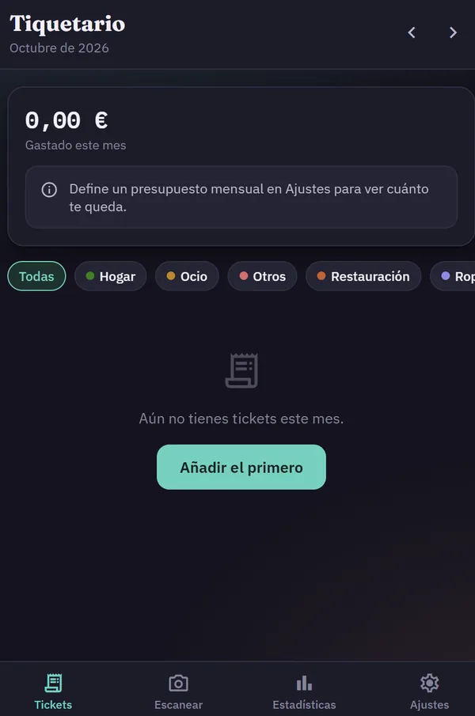
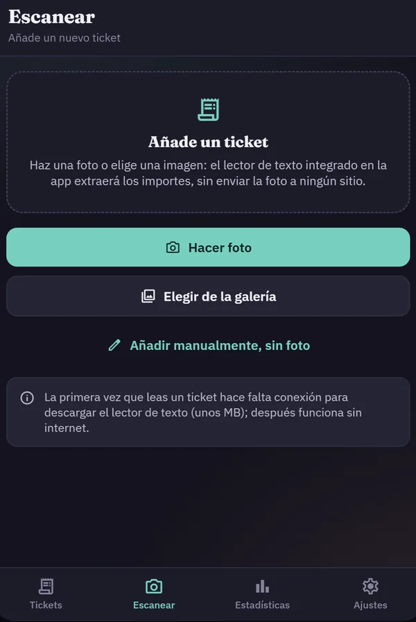
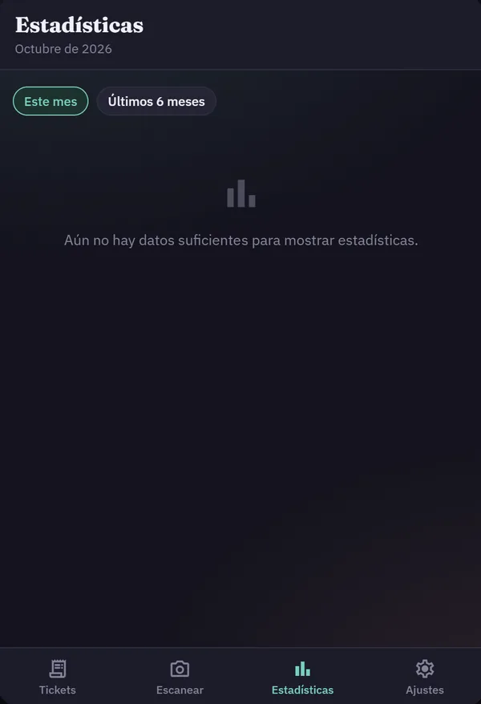
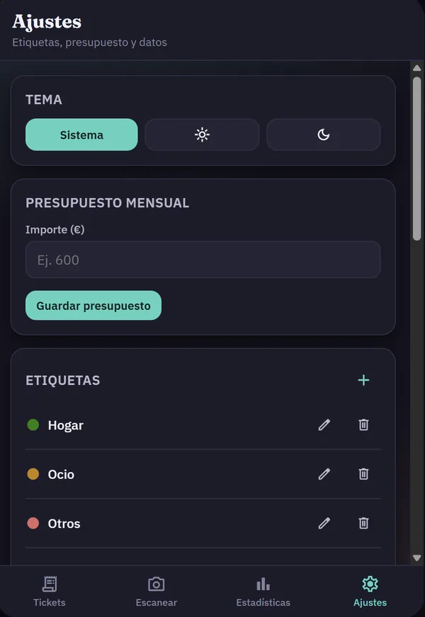
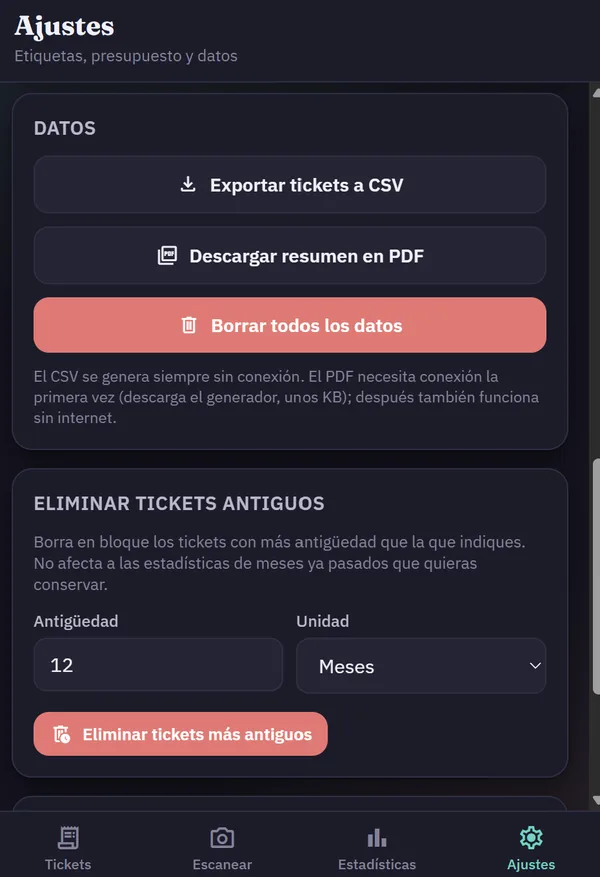

<div align="center">

# Tiquetario

**Tus gastos, desde la foto del ticket.**

Una app web instalable que lee los tickets en tu propio móvil, los organiza por etiquetas y te dice en qué se te va el dinero cada mes. Sin cuentas, sin servidores y sin enviar tus fotos a ningún sitio.

[**Probar la app**](https://francozimm.github.io/tiquetario/) · [Ver en Zimmy](https://zimmy.eu/#gastos)

`JavaScript` `PWA` `Tesseract.js` `IndexedDB` `HTML` `CSS`

</div>

---

## Capturas

<p align="center">
  
  
  
  
  
</p>

## Qué hace

- **Lee el ticket con la cámara.** Haces una foto o eliges una imagen y el lector de texto integrado extrae el importe. Todo ocurre en el dispositivo.
- **Etiquetas a tu medida.** Hogar, ocio, restauración… las creas, las editas y les pones color.
- **Presupuesto mensual.** Defines cuánto quieres gastar y ves cuánto te queda.
- **Estadísticas.** El mes actual y los últimos seis meses, por etiqueta.
- **Tus datos son tuyos.** Exportación a CSV y a PDF (jsPDF), borrado en bloque de tickets antiguos y borrado total.
- **Funciona sin conexión.** Solo necesita internet la primera vez, para descargar el lector de texto.

## Privacidad

Los tickets se guardan en el almacenamiento local del navegador (IndexedDB). No hay backend, ni analítica, ni registro de usuarios. Si borras los datos de la app, desaparecen de verdad.

## Cómo usarla

1. Abre <https://francozimm.github.io/tiquetario/> en el móvil.
2. En el menú del navegador, elige **Instalar aplicación** o **Añadir a pantalla de inicio**.
3. Ve a **Escanear** y haz una foto a tu primer ticket.

Para ejecutarla en local basta con servir la carpeta:

```bash
python -m http.server 8000
# y abrir http://localhost:8000
```

## Estructura

```
index.html        La aplicación completa (interfaz, lógica y estilos)
manifest.json     Datos para instalarla como app (nombre, iconos, colores)
sw.js             Service worker: caché para que funcione sin conexión
icons/            Iconos de la app
docs/capturas/    Imágenes de este README
```

Al cambiar cualquier archivo, sube en uno la constante `VERSION` de `sw.js` para que los móviles que ya la tienen instalada descarguen la versión nueva.

## Próximos pasos

- Detectar automáticamente el comercio y sugerir la etiqueta.
- Gastos recurrentes (suscripciones, recibos).
- Copia de seguridad cifrada opcional.

## Licencia

[MIT](LICENSE) · Franco N. Zimmermann · [zimmy.eu](https://zimmy.eu)
